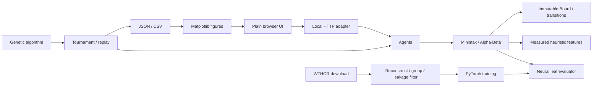

# Architecture

Temporary repository label: `othello-ai`. No final project name has been selected.

| Module | Responsibility |
| --- | --- |
| `engine/board.py` | Board, legal moves, directional captures, passes, terminal states, serialization |
| `engine/evaluation.py` | Separately measured features, weight contributions, terminal utility |
| `engine/search.py` | Explicit MAX/MIN recurrences, pruning, ordering, counters, time mode |
| `engine/agents.py` | Seeded random, greedy and search adapters |
| `evolution/ga.py` | Chromosome operators and actual-game fitness |
| `neural/dataset.py` | Automated source download, parsing, replay, grouped split, leakage filtering |
| `neural/model.py`, `train.py` | Small MLP, training, checkpoint selection, offline metrics |
| `experiments/tournament.py` | Color pairing, common openings, game transcripts, summaries, provenance |
| `experiments/run.py`, `plots.py` | Benchmark/strength studies and figures from saved data |
| `api/server.py` | Stateless JSON game operations, static demo, saved experiment results |
| `web/` | Accessible board controls and evidence display; no duplicated game logic |

The immutable board is a tuple of 64 integers: Black=1, White=-1, empty=0. A move is a row-major index 0–63; a pass is `None`. A state also stores side to move and consecutive passes. Serialized states contain all three fields. Rules end the game when both sides lack a legal move; explicit terminal passes remain representable for testing and replay.

Evaluators implement `(board, perspective) -> bounded score`. Search retains the root player's perspective throughout the tree. Terminal evaluation is shared by every search engine and overrides the leaf evaluator. The neural adapter converts side-to-move predictions to the root perspective. UI requests carry complete board state; there is no account, session database, or separate browser rule engine.

SearchResult counters have explicit semantics: `nodes` includes the root and pass states; `leaves` counts evaluated cutoff or terminal states; `max_depth` counts actual placements; `cutoffs` counts pruning events; `skipped_children` counts immediate sibling branches omitted. Descendant counts are unknown without traversing those subtrees. Exact nodes saved are measured against the corresponding full Minimax search.

Time mode uses iterative depths and a monotonic deadline check at each visited node. An interrupted iteration contributes cost counters but never supplies its partial value/move. A tiny budget can return a deterministic legal fallback at completed depth zero. The CPU deadline is best effort because evaluation and ordering operations cannot be interrupted mid-call. Fixed depth remains the primary evaluator-comparison protocol.

Dependency boundaries: rules/search/GA/tournaments run without PyTorch. Neural imports occur only when neural training/evaluation is requested. Serving manual engines works without research dependencies; neural operations report missing dependencies/artifacts. All generated research artifacts live in the repository, except cached raw/processed public data, which are regenerated from their manifest.
